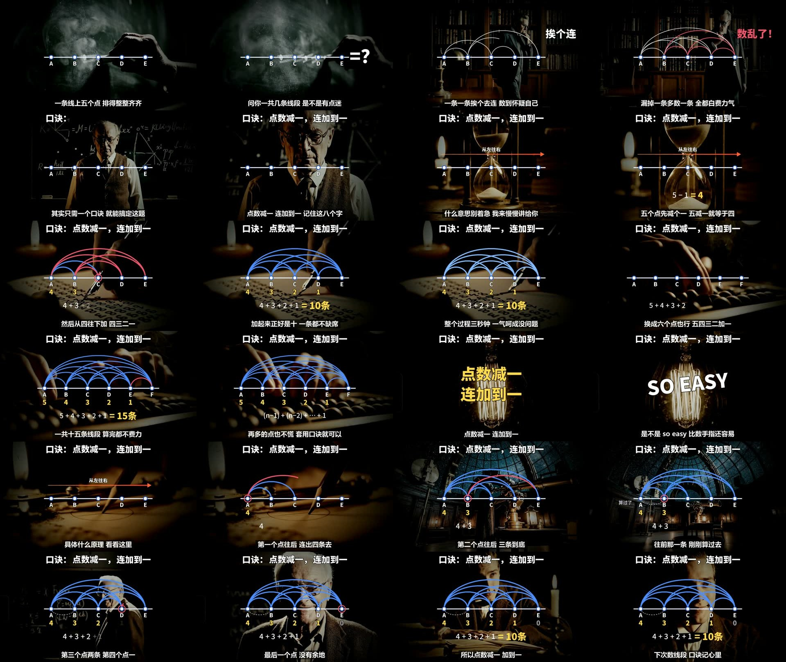
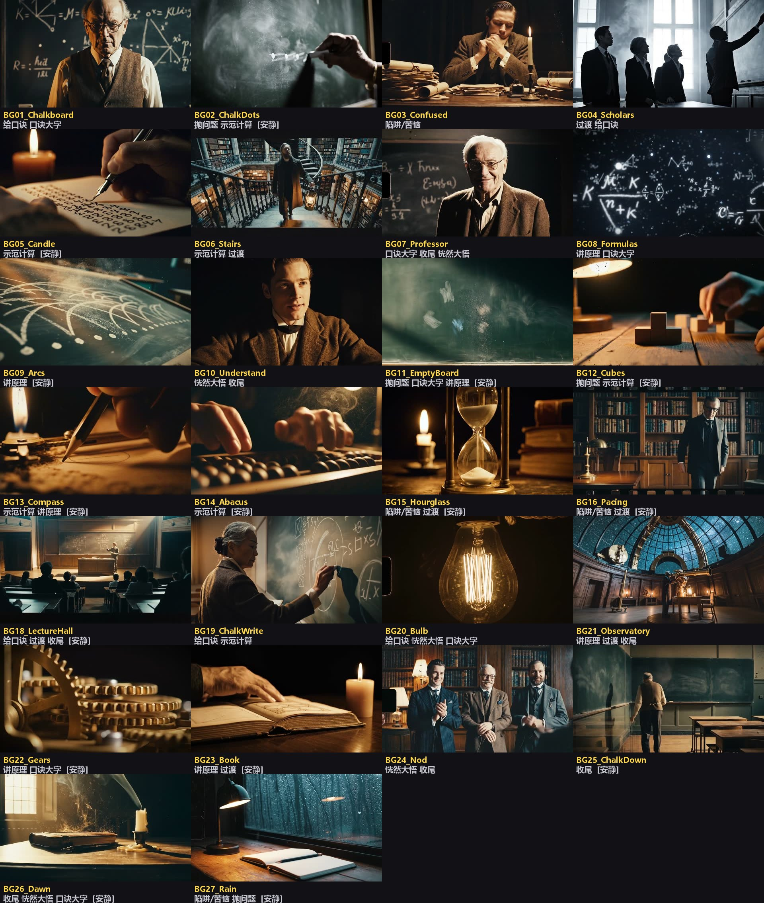

# 口诀讲解视频制作包（math-rap-video）

把一个知识点做成"口诀 + 图形演示"的讲解短视频：暗色电影感背景、顶部常驻口诀、中间图形一步步演示、底部逐句字幕，画面跟着唱词卡点。

这是一个给 AI 助手用的 skill（说明书 + 脚本 + 样例 + 背景素材库）。**音频由你自己准备**（任何 AI 音乐平台生成的歌、真人说唱、普通配音都可以）；背景用自带素材库；图形、口诀、公式、字幕由脚本画出来并合成。Claude、Codex 等能运行命令的 AI 可以直接照着做，只能聊天的 AI 也有对应的用法。



## 样片

| 题目 | 口诀 | 下载 |
|---|---|---|
| 数线段 | 点数减一，连加到一 | [横屏](https://github.com/Yari-tuber/math-rap-video/releases/latest/download/demo_shuxianduan.mp4) · [竖屏](https://github.com/Yari-tuber/math-rap-video/releases/latest/download/demo_shuxianduan_vertical.mp4) |
| 高斯求和 | 首尾相加，乘个数一半 | [横屏](https://github.com/Yari-tuber/math-rap-video/releases/latest/download/demo_gauss_sum.mp4) |
| 三角形内角和 | 三角一百八，减两角得它 | [横屏](https://github.com/Yari-tuber/math-rap-video/releases/latest/download/demo_triangle_angles.mp4) |

样片里的歌是 AI 音乐模型生成的，背景是 AI 视频模型生成的，图形由本包的脚本绘制。

## 原理（三句话）

1. **节奏感是写词时定好的**：每分钟 90 拍，一句歌词正好唱一小节，全篇押一个韵。
2. **画面靠一张"时间表"跟上唱词**：把歌识别一遍，记下每个字是第几秒唱的；分镜里写"第 9 句唱到『四』字时出现 4"，程序自己去查秒数。所以换一版音频、换一个音乐平台，画面都不用改。
3. **图形是程序一张张画的**：AI 只写三份文字（歌词、分镜表、画图程序），脚本负责画图、挑背景、合成，所以数字和图形不会错。

完整讲解和不写代码的做法（剪映）见 [制作教程](references/teaching.md)。

## 里面有什么

| 目录 | 内容 |
|---|---|
| `SKILL.md` | 完整流程。**让 AI 帮你做时，先让它读这个文件** |
| `references/` | 分项说明：怎么写歌词、怎么准备音频、画面怎么写、素材库、常见问题、制作教程、各种 AI 的实测记录 |
| `scripts/` | 命令行脚本（Python） |
| `examples/shuxianduan/` | 完整样例：数线段口诀 |
| `templates/blank/` | 空白模板 |
| `assets/backgrounds/` | 背景素材库的位置。素材库单独下载（见下） |

## 需要准备

- Python 3.10 以上：`pip install pillow numpy librosa pypinyin`
- ffmpeg（命令行里能运行 `ffmpeg` 和 `ffprobe`）
- 背景素材库：到 [Releases](https://github.com/Yari-tuber/math-rap-video/releases/latest) 下载 `backgrounds_library.zip`（26 段背景，约 97 MB）
- 一个 AI 助手，或者会用命令行的人

## 安装

下载本仓库（`git clone`，或在 Releases 里下载 `math-rap-video.skill`，它就是 zip，改后缀即可解压），在文件夹里运行：

```bash
python scripts/install.py --library <backgrounds_library.zip 的路径>
```

```bash
python scripts/install.py --to all
```

```bash
python scripts/check_env.py
```

第一条把素材库放到共享位置（`~/.math-rap-video/backgrounds/`）；第二条把 skill 装进这台电脑上找到的所有 AI 工具；第三条逐项检查环境并告诉你缺什么。`python scripts/install.py --list` 可以看找到了哪些工具。

只用 Claude 的话，也可以直接安装 `math-rap-video.skill`，再运行第一条命令安放素材库。

## 怎么用

### 能读文件、能运行命令的 AI

`install.py` 认识这些工具存放 skill 的位置：

| 工具 | 位置 |
|---|---|
| Claude Code / Claude 桌面版 | `~/.claude/skills/` |
| Codex | `~/.codex/skills/` |
| Gemini CLI | `~/.gemini/skills/` |
| opencode | `~/.config/opencode/skills/` |
| 其他遵循同一约定的工具 | `~/.agents/skills/` |

装好后直接说：

> 帮我做一个讲【知识点】的口诀讲解视频，给【什么人】看。先把口诀、歌词和分镜表写给我确认，不要直接往下做。

如果那个工具没有自动认出这个 skill（比如 Cursor、Trae、通义灵码），就把文件夹放在任意位置，在前面加一句：

> 请先阅读 `<文件夹路径>/SKILL.md`，然后按里面的流程做。需要读 `references/` 里的文件时按 SKILL.md 的指引去读。

之后一共四轮对话：确认歌词 → 你把音频交给它挑 → 看预览图提意见 → 出片。提意见按句号说（"第 9 句的弧线太低"）。

### 只能聊天、不能运行命令的 AI（网页版 ChatGPT、豆包、DeepSeek、Kimi 等）

用 `scripts/chat_pack.py` 生成提示包，整个发给它；脚本由你自己运行：

| 步骤 | 你运行 | 然后 |
|---|---|---|
| 写歌词 | `python scripts/chat_pack.py lyrics "知识点"` | 把生成的文件发给 AI，把它的回答存成 `<作品目录>/lyrics.md` |
| 做音频 | 按 `references/audio.md` 准备，再运行 `prepare_audio.py` | 得到 `timing.json` |
| 写画面 | `python scripts/chat_pack.py visuals <作品目录>` | 把生成的文件发给 AI，把它给的两个文件存进作品目录 |
| 检查修改 | `python scripts/chat_pack.py fix <作品目录>` | 有报错或画面不对：把生成的文件和预览图一起发给 AI，改完再运行一次 |
| 出片 | `python scripts/build_video.py <作品目录> all` | 得到 `成片.mp4` |

### 不想碰代码

看 [制作教程](references/teaching.md) 里的"入门版"：用剪映完成同样的版式。

## 一次完整制作的步骤

1. 定口诀、写歌词和分镜（AI 写，你确认）
2. 你按 `references/audio.md` 的要求准备音频（用哪家平台、谁的声音，你决定）
3. 运行 `prepare_audio.py`：算出每句、每个字的时间，并告诉你这版音频能不能用
4. AI 写 `storyboard.json` 和 `graphics.py`
5. 运行 `check` 和 `sheet`：看每句一格的预览图，确认画面
6. 运行 `build_video.py`：出片（约 10 分钟）。需要竖屏版时再运行 `make_vertical.py`
7. 看一遍成片，重点听口诀和结果数字是否和画面同时出现

换音频时只需要重做第 3、5、6 步。

## 哪些 AI 实际跑通过

Claude、较小的 Claude 模型（Haiku）、Codex 都只凭本包文档独立做出了成片；只能聊天的用法也用较小的模型模拟验证过。Gemini CLI、opencode、Cursor 和各家网页版聊天 AI 没有实测。详情和各模型容易出问题的地方见 [实测记录](references/compatibility.md)。

## 背景素材库



26 段约 8 秒的暗色背景，按 9 种用途打了标签（抛问题、陷阱、给口诀、示范、过渡、口诀大字、讲原理、恍然大悟、收尾），出片时自动挑。可以用 `scripts/library_tool.py` 加自己的片段，见 `references/library.md`。

## 许可证

本仓库的内容（说明书、脚本、样例、模板）按 [MIT 许可证](LICENSE) 发布：可以自由使用、修改、再分发和商用，保留版权声明即可。

## 版权提示

- 音频的版权和商用授权由提供音频的一方确认（各音乐平台的条款不同）
- 自带素材库的片段是用 AI 视频模型生成的通用背景；你自己加入的片段请确认有权使用
- 视频版式参考了抖音上"口诀 + 说唱"类数学科普视频的常见做法；本包不包含任何他人的视频、音乐或素材
