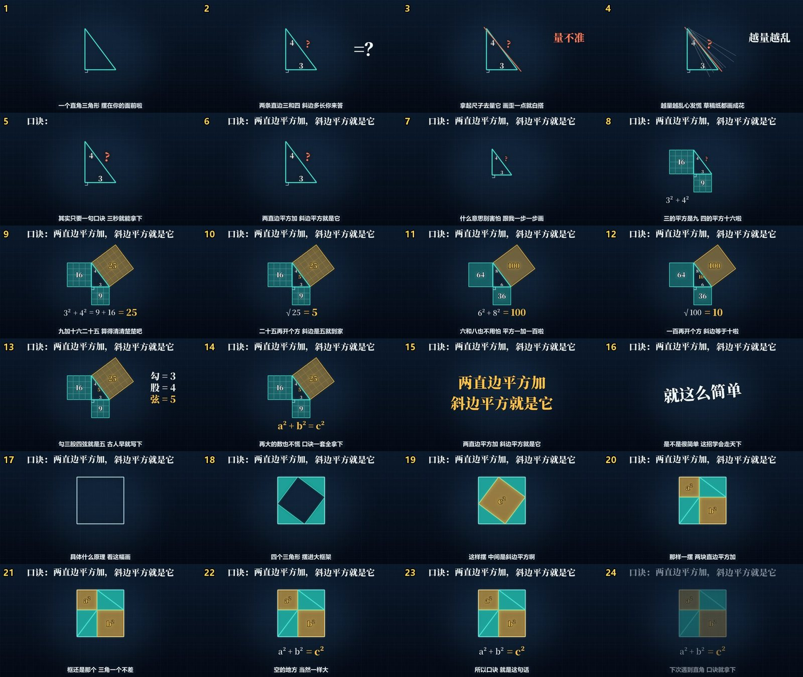
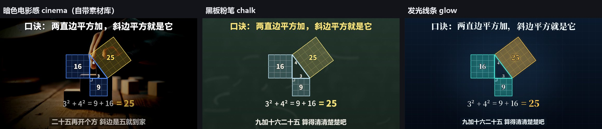

# 口诀说唱讲题视频（math-rap-video）

把一个知识点做成「AI 说唱 + 口诀 + 图形演示」的讲题短视频：顶部常驻口诀，中间图形跟着唱词一步步演示，底部逐句字幕，结果数字卡在唱到它的那一下。

这是一个给 AI 用的 skill：Claude Code、Codex、DeepSeek Harness、Gemini CLI、opencode、Cursor……能读文件、能跑命令的 AI 都能照着做；只能聊天的 AI 也有用法。



## 2.0 有什么新的

- **用什么音乐模型都行。** 有 API 就让 AI 直接生成（现在支持 ElevenLabs）；没有就用 skill 给的提示词去 Suno、海绵音乐、Mureka 网页生成，下载回来丢进去。
- **不用再自己出字幕。** 丢进一首 mp3，skill 自己分出人声、按歌词把每个字对到第几秒唱、量哪一版最好、查哪句可能没唱。Suno 的 mp3 里嵌着歌词，连歌词都能自己读出来。
- **画风和背景都能换。** 自带三套画风（暗色电影感、黑板粉笔、发光线条），背景能换成自带素材库、自己的视频文件夹、一张图或纯色。改一个词就换，题目图形不用动。
- **提示词都在里面。** 写口诀和歌词的提示词、给各家音乐模型的提示词，复制就能用。
- **一个入口。** 所有步骤都是 `scripts/mrv.py` 的一条命令，每步做完打印下一条完整命令，较弱的模型也能照着走完。
- 新样例：**勾股定理**，原理段用拼图证明（四个三角形换个摆法，空出来的面积一样大）。

## 原理（三句话）

1. **好记是写词时定好的。** 每分钟 90 拍，一句歌词正好一小节，全篇押一个韵，口诀单独唱两遍。这样耳朵能预判下一句什么时候来。
2. **画面靠一张时间表跟上唱词。** 先把歌里每个字第几秒唱对出来；分镜里写「第 9 句唱到『四』时出现 4」，程序自己去查秒数。所以换一版歌、换一家音乐模型，画面都不用改。
3. **图形是程序一帧帧画的，不是视频模型生成的。** AI 只写歌词、分镜和画图程序，数字和图形不会画错。

## 安装

要 Python 3.11 以上和 ffmpeg（Windows：`winget install Python.Python.3.12`、`winget install Gyan.FFmpeg`）。

```bash
git clone https://github.com/Yari-tuber/math-rap-video.git
```

```bash
python math-rap-video/scripts/install.py --to all
```

```bash
python math-rap-video/scripts/mrv.py doctor --fix
```

第一条下载；第二条把 skill 装进这台电脑上的 AI 工具（`~/.agents/skills` 通用位置，Codex、Gemini CLI、opencode、Cursor、DeepSeek Harness 都读；再加 `~/.claude/skills`、`~/.dsh/skills`，以及 Trae、Qoder 这些找到了的），顺便下好背景素材库（97 MB）；第三条检查环境，缺的自动装进一个独立环境（不碰你系统里的 Python）。对齐模型第一次用时自动下载约 1.8 GB，国内网络先设 `HF_ENDPOINT=https://hf-mirror.com`。

装完在 AI 工具里**新开一个对话**。

## 怎么用

对 AI 说：

> 用 math-rap-video 把【勾股定理】做成口诀说唱讲题视频。先把口诀和歌词给我确认，再往下做。

它会照这个顺序走，每一步做完会告诉你结果：

1. **写口诀和歌词**：先验算每个数字、写清口诀成立的前提、想好评论区会挑什么刺，再写。你确认。
2. **出歌**：它会问你「有没有音乐模型的 API」。有就给它密钥，它直接生成两三版（会先告诉你要花多少额度）；没有，它把排好的提示词给你，你去 Suno / 海绵 / Mureka 生成两三首，下载回来交给它。
3. **对时间、挑一版**：它告诉你选了哪版、为什么，哪几句要你听一下。
4. **写画面**：出每句一格的预览图，你提意见（按句号说，比如「第 9 句的正方形再大一点」）。
5. **出片**：横屏，需要的话再出一条竖屏。

## 提示词（直接复制）

| 文件 | 用途 |
|---|---|
| [`prompts/写词.md`](prompts/写词.md) | 写口诀和歌词。交给任何 AI 都行，可以选「口诀型」（公式、方法）或「反直觉型」（悖论、谜题） |
| [`prompts/音乐模型/Suno.md`](prompts/音乐模型/Suno.md) | Suno：设置、三套风格词、排除词、歌词框写法 |
| [`prompts/音乐模型/海绵音乐.md`](prompts/音乐模型/海绵音乐.md) | 海绵音乐（免费、国内直接能用） |
| [`prompts/音乐模型/Mureka.md`](prompts/音乐模型/Mureka.md) | Mureka |
| [`prompts/音乐模型/通用.md`](prompts/音乐模型/通用.md) | 任何音乐模型（这串风格词在 ElevenLabs 上实测过）+ 实测经验 |

跑 `mrv.py lyrics` 时，这几份会自动把你的歌词填进去（数字写成汉字、去掉括号，模型唱得更准），放在作品目录的 `给音乐模型/` 里。

Suno 那份按官方文档和社区经验整理，作者没有 Suno 会员、没有亲自实测；用下来哪里不对，欢迎提 issue。

## 画风和背景



```json
"style": "glow"
```

| 画风 | 样子 | 背景 |
|---|---|---|
| `cinema` | 暗色电影感，蓝色图形、黄色结果数字 | 自带素材库：26 段 AI 生成的暗色镜头，按用途自动挑（抛问题、陷阱、给口诀、示范……） |
| `chalk` | 黑板粉笔 | 墨绿黑板 |
| `glow` | 发光线条，粗宋体口诀 | 深蓝网格 |

背景换成自己的：`"backgrounds": {"source": "folder", "path": "我的视频文件夹"}`，或 `{"source": "image", "path": "图.jpg"}`，或 `{"source": "color", "color": "#101820", "texture": "grid"}`。自己做画风见 [`references/styles.md`](references/styles.md)。


## 只能聊天的 AI（网页版 ChatGPT、豆包、DeepSeek、Kimi 等）

用 `scripts/chat_pack.py` 生成提示包发给它，命令由你自己运行：

| 步骤 | 你运行 | 然后 |
|---|---|---|
| 写歌词 | 把 `prompts/写词.md` 和知识点发给它 | 把它给的歌词存成 `<作品目录>/lyrics.md`，运行 `python scripts/mrv.py lyrics <作品目录>` |
| 出歌 | 打开 `<作品目录>/给音乐模型/`，照着去音乐平台生成 | 运行 `python scripts/mrv.py song <作品目录> --song 歌.mp3` |
| 写画面 | `python scripts/chat_pack.py visuals <作品目录>` | 把生成的文件发给它，把它给的两个文件存进作品目录 |
| 检查修改 | `python scripts/mrv.py check <作品目录>`，有问题再 `python scripts/chat_pack.py fix <作品目录>` | 把生成的文件和预览图一起发给它，改完再检查 |
| 出片 | `python scripts/mrv.py render <作品目录>` | 得到 `成片.mp4` |

## 不想碰代码

看 [制作教程](references/teaching.md) 里的剪映做法。

## 实测

- 2.0：勾股定理从写词、用 ElevenLabs 接口出两版歌、自动对时间（两版都可用，选了 24 句全部落在小节头的那版）到出片走通。只用强制对齐的时间，和「识别 + 对齐」合起来的结果几乎一样（24 句里 22 句起点完全相同，另外 2 句差 0.08 秒）。往歌词里塞一句没唱的，能查出来。
- 1.x：Claude、Claude Haiku、Codex 只凭文档独立做出过成片。详情见 [实测记录](references/compatibility.md)。

## 致谢

- 逐字对齐：[Qwen3-ForcedAligner-0.6B](https://huggingface.co/Qwen/Qwen3-ForcedAligner-0.6B-hf)（阿里通义千问团队，Apache-2.0），运行时下载，不随本包分发。
- 人声分离：[demucs](https://github.com/facebookresearch/demucs)（Alexandre Défossez / Meta，MIT）。
- 节拍检测 [librosa](https://github.com/librosa/librosa)（ISC），拼音匹配 [pypinyin](https://github.com/mozillazg/python-pinyin)（MIT）。
- 版式参考了抖音上「口诀 + 说唱」类数学科普视频（比如 Rap&科学）的常见做法；本包不包含任何他人的视频、音乐或素材。

## 许可证

[MIT](LICENSE)：可以自由使用、修改、再分发和商用，保留版权声明即可。

## 版权提示

- 歌的版权和商用授权看你用的音乐平台：比如 Suno 免费档不能商用，ElevenLabs Creator 档起可以，海绵、Mureka 以各自协议为准。
- 自带素材库是用 AI 视频模型生成的通用背景；你自己加入的片段请确认有权使用。不要拿电影片段当背景。
